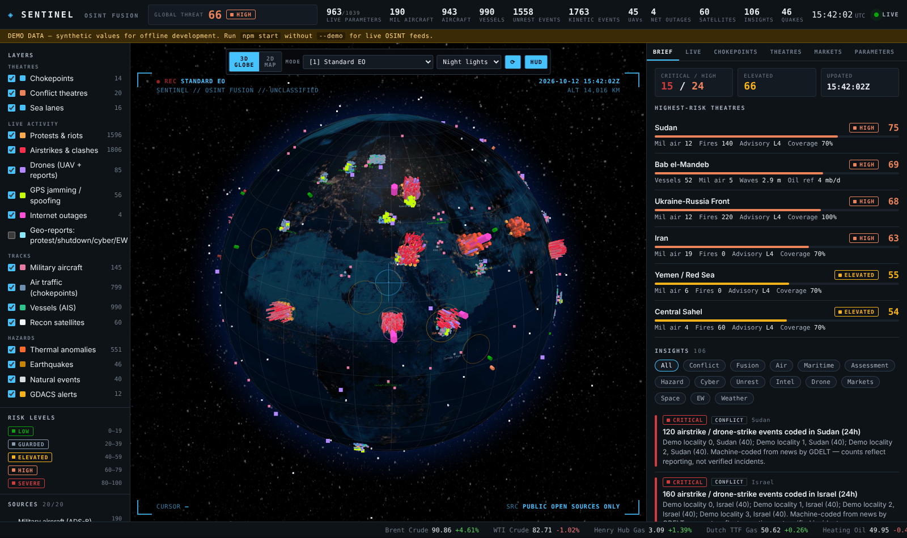
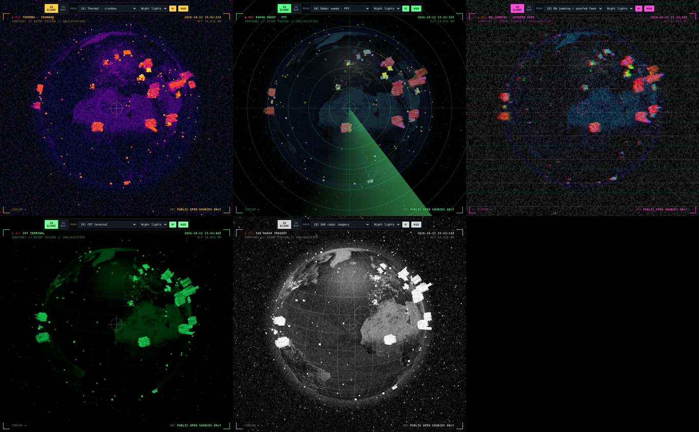

# SENTINEL — OSINT Fusion Board

A Palantir-style, real-time situational-awareness web app built only from **open-source intelligence**.
It fuses live military aviation, ship traffic, conflict reporting, natural hazards, cyber, space weather and
markets onto one dark operations map. It scores every maritime chokepoint and conflict theatre, and it
writes explainable insights when something crosses a threshold.

- **3D globe or 2D map.** The globe (globe.gl / three.js) shows extruded incident columns, protest hex-bins, pulsing theatres, animated sea lanes, aircraft at flight level, ships, and satellites at orbital altitude. The 2D map (Leaflet) shows the same layers.
- **24 sensor-style visual modes plus a spy-style HUD.** Modes include night vision, thermal palettes, SAR, radar and EW jamming (full list below). Keys `1–0` and `q…f` switch modes; `[` and `]` cycle through them.
- **Live activity.** Protests, riots, airstrikes and drone strikes, and armed clashes come from GDELT's 15-minute event stream. Also shown: UAVs broadcasting ADS-B, GPS jamming and spoofing inferred from aircraft navigation accuracy, internet outages with their causes, and geolocated drone, shutdown, cyber and jamming reports.
- **1,000+ tracked parameters.** 14 chokepoints × 27, 20 theatres × 26, plus 110–135 global indicators (the count depends on how many countries have events). The header shows how many are live right now.
- **20 independent sources.** If one fails, the rest of the board keeps working, and the Sources panel shows each source's state, item count, last success and last error.
- **Live updates.** The server polls each source on its own schedule and pushes version bumps over Server-Sent Events. The browser then pulls only the layer that changed.
- **No server dependencies, no build step.** Needs Node 22 and nothing else. Leaflet, globe.gl and satellite.js load from CDNs.





## Run

```bash
cd sentinel
npm start            # live OSINT  → http://localhost:8080
npm run demo         # offline synthetic data (labelled DEMO DATA in the UI)
npm test
```

Optional free keys go in `sentinel/.env` (see `.env.example`):

| Key | Unlocks |
|---|---|
| `AISSTREAM_API_KEY` ([aisstream.io](https://aisstream.io)) | Live AIS ship positions at all 14 chokepoints: vessel counts, tanker/cargo mix, stopped-ship share, transit speed |
| `FIRMS_MAP_KEY` ([NASA FIRMS](https://firms.modaps.eosdis.nasa.gov/api/map_key/)) | VIIRS thermal anomalies in conflict theatres (shelling, strikes on fuel or infrastructure, wildfire) |
| `CLOUDFLARE_API_TOKEN` ([Cloudflare Radar](https://developers.cloudflare.com/radar/)) | Internet outages with cause: government-directed shutdown, power, cable cut |

Without keys you still get Baltic ship traffic (Digitraffic) and every other layer.

Docker: `docker build -t sentinel sentinel && docker run -p 8080:8080 --env-file sentinel/.env sentinel`

## Sources

| Domain | Source | What it feeds |
|---|---|---|
| Air | adsb.lol / airplanes.live `/v2/mil` | Global military aircraft broadcasting ADS-B, ISR/tanker/AEW detection, emergency squawks |
| Air | adsb.lol point queries | All air traffic around each chokepoint (one rolling query at a time) |
| Maritime | aisstream.io (WebSocket) | Ships inside each chokepoint's bounding box |
| Maritime | Fintraffic Digitraffic | Baltic AIS, no key |
| Maritime | Open-Meteo forecast + marine | Wind, gusts, visibility, wave height, swell, SST, currents at each chokepoint |
| Intel | GDELT 2.0 DOC API | Per-theatre 24h article volume, surge vs 6-day mean, media tone, tone shift, headlines |
| Intel | US State Dept | Travel advisory level per country |
| Hazards | USGS | Earthquakes M2.5+ (24h), tsunami flags, PAGER alerts |
| Hazards | NASA EONET | Open wildfires, storms, volcanoes, floods |
| Hazards | GDACS | UN/EC disaster alerts (red/orange/green) |
| Hazards | NASA FIRMS | VIIRS thermal anomalies in theatres |
| Cyber | CISA KEV | Newly exploited CVEs, ransomware-linked additions |
| Cyber | IODA (Georgia Tech) | Country-level internet outage alerts (BGP, active probing, telescope) |
| Space | NOAA SWPC | Kp index and alerts (GNSS/HF degradation, which can mask or mimic jamming) |
| Markets | Yahoo Finance chart API | Brent, WTI, TTF, gold, wheat, VIX/OVX, exposed-economy FX, shipping and defense equities |
| Markets | CoinGecko | BTC/ETH/USDT, used as capital-flight and sanctions proxies |
| Events | GDELT 2.0 Event stream (15-min export files) | Geocoded protests (CAMEO 140–144), riots (145), airstrikes and drone strikes (195), armed clashes (190/193/194) and mass violence (20x), kept as a rolling 24h window |
| Events | GDELT GEO 2.0 API | Geolocated reporting on drones, protests, internet shutdowns, cyberattacks and GPS jamming |
| EW | ADS-B NACp / NIC fields | Share of aircraft with degraded GNSS accuracy around each chokepoint (the gpsjam.org method) |
| Drones | ADS-B type and callsign | UAVs broadcasting ADS-B (RQ-4, MQ-9, MQ-4C, TB2, Heron…) |
| Cyber | Cloudflare Radar (optional) | Outage annotations with cause and scope |
| Space | CelesTrak TLEs + SGP4 in the browser | Military, earth-observation, radar and GNSS satellites: live positions, ground tracks, "satellites overhead" for each theatre |

## Visual modes

| Key | Mode | Key | Mode |
|---|---|---|---|
| 1 | Standard EO | w | Radar sweep (PPI) |
| 2 | Night vision, Gen-3 green | e | Sonar |
| 3 | Night vision, white phosphor | r | CRT terminal |
| 4 | Thermal white-hot | t | Amber monitor |
| 5 | Thermal black-hot | y | Hologram table |
| 6 | Thermal ironbow | u | Red light (dark-adapted) |
| 7 | Thermal rainbow HC | i | Blueprint |
| 8 | Thermal arctic | o | EW jamming / spoofed feed |
| 9 | Thermal lava | p | Chromatic aberration |
| 0 | Satellite recon (sharpened) | a | Hyperspectral false colour |
| q | SAR radar imagery | s | Data rain |
| | | d / f | Archive film / Inverted |

Each mode is an SVG or CSS filter applied to the rendered map or globe, plus optional overlays (scanlines, sensor noise, vignette, radar sweep, range rings, glitch tears, data rain). The modes are cosmetic and do not change the data. With `prefers-reduced-motion` set, the animations are switched off.

## How scoring works

Each chokepoint and theatre gets a 0–100 **composite risk score**. The score is a weighted sum of normalised components:

- **Chokepoints:** news surge 25, negative tone 20, military air 20, sea state 15, traffic stoppage 10, hazards 10, kinetic events nearby 10, GNSS interference 10.
- **Theatres:** news surge 20, tone 20, military air 15, thermal anomalies 10, travel advisory 15, internet outages 10, hazards 10, armed-violence events 15, civil unrest 10, drone activity 10.

**Fusion rule:** a country gets a CRITICAL insight when an internet outage there (an IODA critical alert or an ongoing Cloudflare outage) coincides with ≥5 protest or riot events in the same 24h. That pattern is consistent with a government-directed shutdown.

When a component has no data, it is **dropped and the score is renormalised**. The **model coverage %** shown next to every score tells you how much of the model had data, so a thin score is never mistaken for a calm one. The detail drawer shows each component's contribution ("Why this score"), a 24h score history, a 7-day news volume and tone trend, and every parameter for that place.

**Levels:** LOW <20 · GUARDED 20–39 · ELEVATED 40–59 · HIGH 60–79 · SEVERE 80+.
The **Global Threat Index** is the mean of the five highest-scoring theatres.

**Insights** come from rules, not a black box. Examples:

- ≥3 military aircraft near a chokepoint
- news surge ≥1.8×
- ≥60% of vessels stopped
- waves ≥3.5 m or gusts ≥40 kn
- M6+ earthquake nearby
- ISR aircraft clusters over a theatre
- critical internet outages
- ≥100 thermal anomalies
- Kp ≥5
- energy price moves ≥3%
- KEV bursts
- GDACS red alerts
- emergency squawks
- a score rising ≥15 points in an hour

Each insight carries the evidence that triggered it.

## Caveats (read before acting on anything)

- **ADS-B and AIS only show what transmits.** Many military aircraft and warships fly or sail dark. Absence of contacts is not absence of activity.
- **GDELT measures media attention, not ground truth.** Surge and tone are early-warning signals to corroborate, not facts.
- **GDELT events are machine-coded from news.** One incident can be coded several times, and some are mis-geocoded. Read counts as the intensity of reporting, not as verified incidents. Events geocoded only to a country centroid are dropped.
- **GNSS degradation does not prove jamming.** Low NACp can also come from avionics or a geomagnetic storm (check the Kp index). Only clusters across many aircraft are meaningful.
- **Thermal anomalies are not attributed.** Strikes, industrial flares and wildfires look alike.
- **Oil-flow figures are reference baselines.** They come from EIA and others for 2023–24 and are labelled as such. They are not live flows.
- **Each community API has its own terms and rate limits.** The rolling queues (one GDELT DOC call per 7 s, one GEO call per 30 s, CelesTrak at most once every 4 h per group, one market symbol per 8 s, one adsb.lol point query per 15 s) are tuned to respect them. Check each provider's terms before commercial use.

## Layout

```
sentinel/
  server.js          HTTP + SSE server, static files
  lib/catalog.js     chokepoints, theatres, market instruments
  lib/feeds.js       one fetcher + normaliser per source
  lib/ais.js         aisstream.io WebSocket client
  lib/analytics.js   parameter registry, composite scores, insight rules
  lib/engine.js      scheduler, health, history, layer versions
  lib/events.js      GDELT 2.0 event-stream reader (zip + CAMEO classification)
  lib/countries.js   country centroids for outage markers
  lib/demo.js        offline fixtures in each vendor's real format (demo + tests)
  public/app.js      panels, 2D map (Leaflet canvas glyph layers), satellites (SGP4)
  public/globe.js    3D globe view
  public/fx.js       visual modes and overlays
  test/              node:test suite
```
